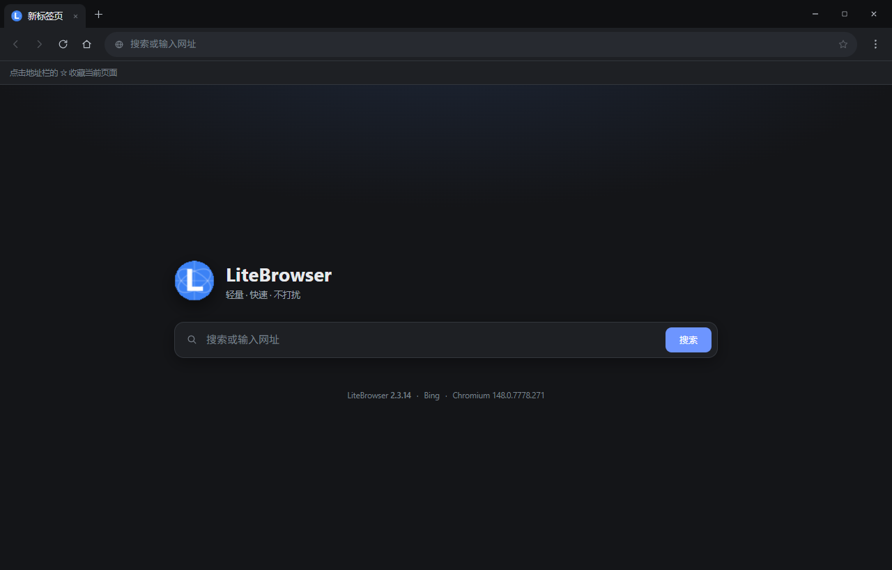
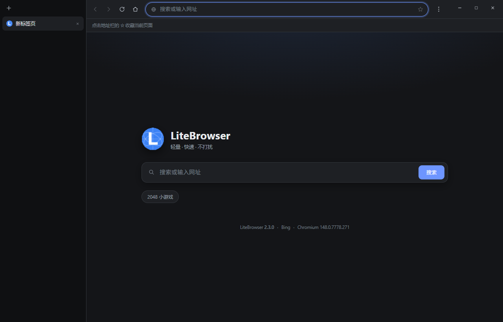
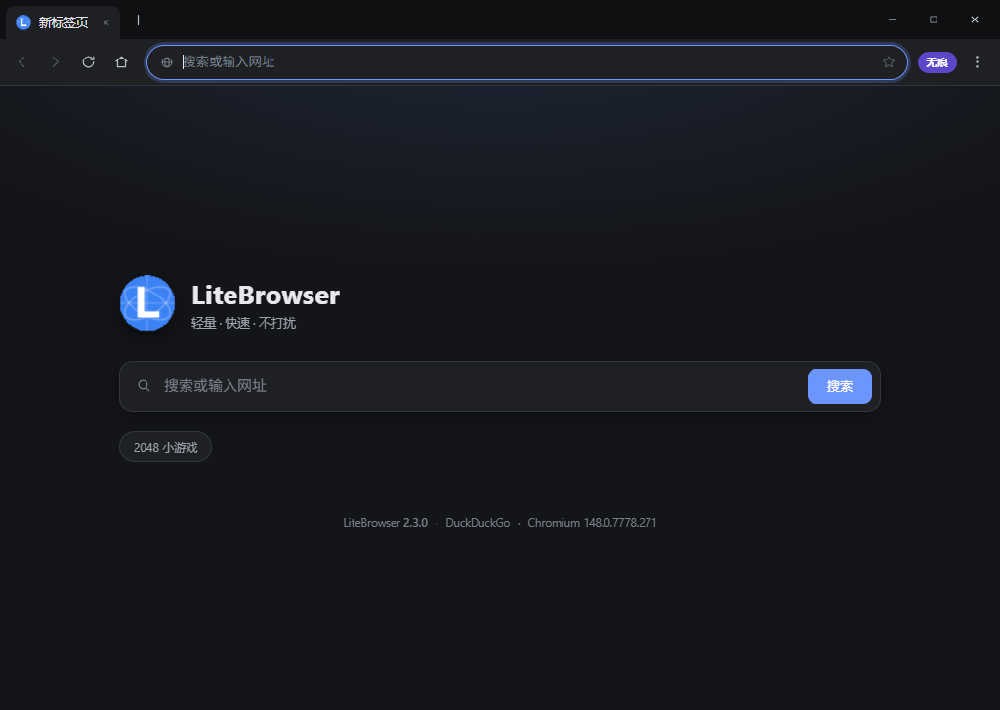
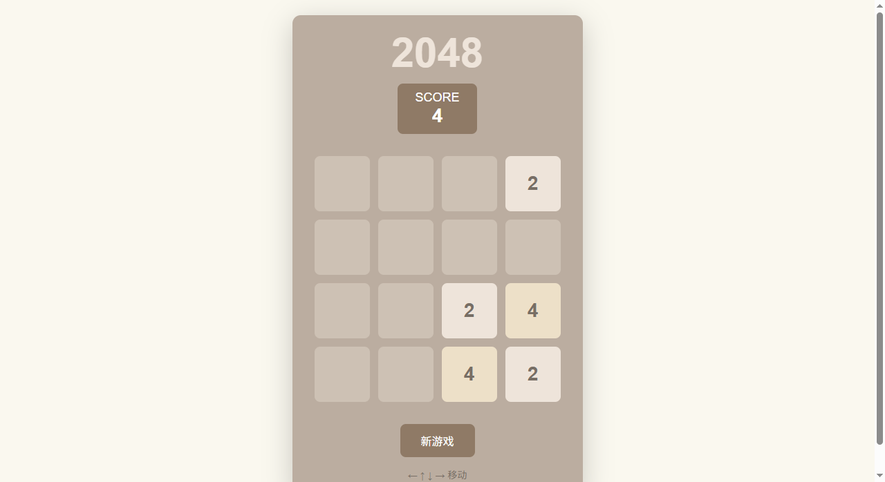
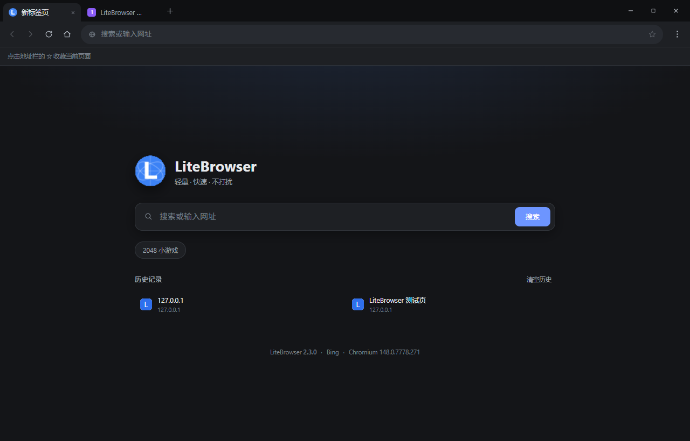
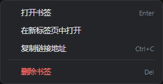
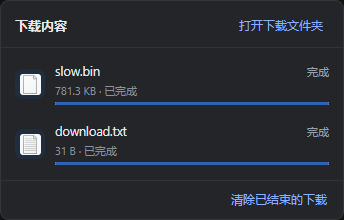
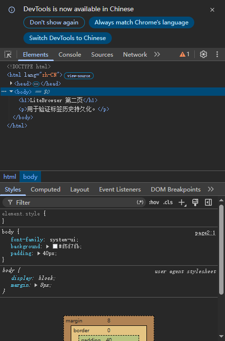

# LiteBrowser 2.3.14

LiteBrowser 是一个基于 **Electron** 的轻量多标签浏览器。窗口外壳、标签栏、地址栏、书签栏和右键菜单全部自绘，网页内容通过 Electron 的 `WebContentsView` 独立渲染，页面进程与界面进程互相隔离。



## 功能

- **多标签浏览**：标签栏高度固定，标签宽度随数量自动压缩；新建、关闭、拖拽排序都有动画。支持中键关闭、**双击标签页关闭**、恢复关闭的标签页；可在「设置」中切换**垂直标签页**。
- **垂直标签页**：标签栏移到左侧，页面区域自动让出侧栏；开关默认关闭，拖拽排序在垂直模式下同样可用。

  

- **无痕窗口**：`Ctrl+Shift+N` 或菜单「新建无痕窗口」打开独立窗口，使用内存分区，不写入 Cookie、历史、书签或标签页会话；默认搜索引擎为 **DuckDuckGo**，关闭最后一个无痕窗口后清理临时数据。

  

- **2048 小游戏**：完全离线的 2048，方向键 / WASD 移动，支持分数和新游戏；从菜单「2048 小游戏」打开（起始页不再放快捷按钮）。

  

- **HTML 文件关联**：安装包把 `.html` / `.htm` 关联到 LiteBrowser（安装向导中的关联选项默认勾选）。双击 HTML 文件时通过 `file` 协议启动程序，或通过 `second-instance` 唤起已运行的实例，文件会作为新标签页打开。
- **安装协议**：安装向导显示 EULA，必须勾选接受协议才能继续；覆盖安装会保留用户数据，卸载时会询问是否保留书签和历史记录。

- **智能地址栏**：识别完整 URL、域名、`localhost` / IP，其余输入交给所选搜索引擎（Bing / Google / DuckDuckGo / 百度）。新建标签页始终是空白起始页，不会带上前一个页面的链接。
- **起始页**：只保留品牌、搜索框和历史记录，不再显示常用网站卡片；起始页和起始页标签使用 LiteBrowser 的矢量标志。历史记录带网站图标，支持右键删除单条记录，也可以一键清空全部历史。

  
- **内存优化**：启用 `process-per-site`，相同站点的标签页共享渲染进程，减少多开标签时的进程开销。
- **书签**：地址栏星标收藏，书签栏展示网站真实图标（收藏时记录页面 favicon，并自动尝试站点 `/favicon.ico`）；右键书签可打开、新标签打开、复制链接或删除。
- **自绘右键菜单**：网页内容、书签、标签页、历史记录和下载项的右键菜单都是应用内绘制的浮层（独立窗口），可以覆盖在网页视图之上，不受 `WebContentsView` 层级限制。菜单项显示对应的键盘快捷键（如 `Ctrl+C`、`Del`、`F12`），也可以用方向键选择、回车执行，或直接按菜单里的快捷键触发。

  

- **页面内查找**：`Ctrl+F` 打开查找栏，实时显示匹配数，回车 / Shift+回车跳转。
- **缩放**：`Ctrl +/-` 缩放当前页面，`Ctrl+0` 还原，工具栏显示当前比例。
- **下载器**：
  - 工具栏下载按钮显示环形进度与数量角标；
  - 下载气泡每项显示 **Windows 给该文件分配的图标**（如记事本、压缩包等；取不到时回退到文档图标）和深蓝色进度条，显示实时速度；
  - 下载中点击文件不会打开，支持暂停 / 继续；
  - 完成或失败不再弹系统通知；
  - 下载中的右键菜单：**重新下载 / 复制下载地址 / 在列表中删除 / 取消并删除**（另有暂停/继续）；
  - 已完成文件的右键菜单：**重新下载 / 复制下载地址 / 打开文件所在的文件夹 / 在列表中删除 / 删除文件**；
  - 可在「设置 → 下载文件夹…」自定义保存路径，默认使用系统下载目录。

  

- **内嵌开发者工具**：`F12` 在窗口右侧停靠显示 DevTools，不弹出独立窗口；切换标签页时各自保留。

  

- **主题与设置**：设置里可选择**浅色 / 深色 / 跟随系统**，默认跟随系统；可切换**垂直标签页**（默认关）和**启动时恢复上次标签页**（默认开），以及下载目录、书签栏等。切换主题时会把颜色方案同步给 `prefers-color-scheme`，网站会跟随切换深浅色。
- **持久化**：会话会保存每个标签页的**前进/后退历史**，重启后恢复标签页和浏览历史；Chromium 的 Cookie、缓存、Local Storage 等保存在独立目录中，重启后保留登录状态。无痕窗口不参与这些持久化。
- **窗口**：无边框标题栏、自绘最小化 / 最大化 / 关闭按钮、拖动标题栏移动、双击最大化、`F11` 全屏。
- **安全**：页面启用 `sandbox` + `contextIsolation`，禁用 `nodeIntegration`，自定义 CSP；摄像头、麦克风、定位、通知等敏感权限默认拒绝；只允许 `http(s)` / `file` 协议导航。

## 运行
- **用户使用**：

    环境：Windows 10/11 ，下载链接(密码均为lite)：

    **Installer** 
    ```
    https://cmdplayer.lanzouq.com/iUxaB4fjuati
    ```

    **Portable** 
    ```
    https://cmdplayer.lanzouq.com/i6Gly4fju8ah
    ```

- **测试环境**：

    环境：Windows 10/11、Node.js ≥ 22.12。`node_modules` 里的 Electron 已安装好；如果重新安装依赖时 Electron 二进制下载失败，可指定镜像：

    ```powershell
    $env:ELECTRON_MIRROR = "https://npmmirror.com/mirrors/electron/"
    npm install
    ```

    启动：

    ```powershell
    npm start
    ```

## 快捷键

| 快捷键 | 功能 | 快捷键 | 功能 |
| --- | --- | --- | --- |
| `Ctrl+T` | 新建标签页 | `Ctrl+W` | 关闭当前标签页 |
| `Ctrl+Shift+T` | 恢复关闭的标签页 | `Ctrl+Tab` / `Ctrl+Shift+Tab` | 切换标签页 |
| `Ctrl+1` … `Ctrl+8` | 跳到第 N 个标签页 | `Ctrl+9` | 跳到最后一个标签页 |
| `Ctrl+L` / `F6` | 聚焦地址栏 | `Ctrl+R` / `F5` | 重新加载 |
| `Ctrl+Shift+R` | 忽略缓存重新加载 | `Ctrl+F` | 页面内查找 |
| `Ctrl+D` | 收藏 / 取消收藏 | `Ctrl+Shift+B` | 显示 / 隐藏书签栏 |
| `Alt+←` / `Alt+→` | 后退 / 前进 | `Alt+Home` | 回到主页 |
| `Ctrl+=` / `Ctrl+-` / `Ctrl+0` | 放大 / 缩小 / 还原 | `F11` | 全屏 |
| `F12` / `Ctrl+Shift+I` | 内嵌开发者工具 | `Esc` | 停止加载 / 关闭查找 / 关闭菜单 / 退出全屏 |
| `Ctrl+Shift+N` | 新建无痕窗口 |  |  |

鼠标操作：拖动标签调整顺序；中键或双击标签页关闭；右键网页、书签、标签页或下载项打开自绘菜单。

## 目录结构

```
LiteBrowser/
├─ package.json                 # 名称 LiteBrowser、版本 2.3.14、构建配置
├─ FAVICON.ico                  # 应用图标
├─ EULA.txt                     # 安装向导显示的最终用户许可协议
├─ build/
│  └─ installer.nsh             # NSIS 自定义页面：文件关联、卸载个人数据询问
├─ scripts/
│  ├─ patch-nsis.js             # 打包前启用 NSIS 安装/卸载详情
│  └─ smoke.js                  # 冒烟测试启动器（npm run smoke）
├─ src/
│  ├─ main/
│  │  ├─ main.js                # 生命周期、单实例/文件参数、数据路径、主题、IPC
│  │  ├─ window.js              # 窗口、标签页、WebContentsView、DevTools、下载
│  │  ├─ overlay.js             # 自绘菜单 / 下载气泡的透明浮层窗口
│  │  ├─ menus.js               # 原生应用菜单 + 网页右键菜单数据
│  │  ├─ store.js               # 本地 JSON 持久化（书签、历史、设置、标签历史）
│  │  ├─ config.js              # 名称、版本、搜索引擎、UA、地址栏解析
│  │  └─ smoke.js               # 冒烟测试用例（由 npm run smoke 触发）
│  ├─ preload/
│  │  └─ preload.js             # contextBridge 暴露的受限 API
│  ├─ overlay/
│  │  ├─ index.html             # 浮层骨架
│  │  ├─ overlay.css            # 菜单、下载气泡、深浅色样式
│  │  ├─ overlay.js             # 浮层渲染、键盘快捷键与交互
│  │  └─ preload.js             # 浮层 IPC 桥
│  ├─ games/
│  │  └─ 2048/                  # 离线 2048 小游戏（单文件 HTML）
│  └─ renderer/
│     ├─ index.html             # 自绘界面骨架 + CSP
│     ├─ styles.css             # 界面样式、标签动画、深色主题
│     ├─ app.js                 # 标签页 / 地址栏 / 起始页 / 查找 / 下载按钮逻辑
│     └─ assets/logo.svg        # LiteBrowser 矢量标志
└─ docs/screenshots/            # README 截图
```

## 用户数据

LiteBrowser 自己的数据和浏览器的 Cookie/缓存分开存放：

```
%APPDATA%\LiteBrowser\
├─ data\
│  └─ litebrowser-store.json    # 书签、历史、设置、窗口位置、标签页历史
└─ browser-data\                # Cookie、缓存、Local Storage、站点数据
```

- `litebrowser-store.json` 里的 `session.tabs` 保存每个标签页的导航条目和当前索引，启动时通过 Chromium 的导航历史恢复前进/后退记录；标签页、窗口状态和导航变化后会自动保存，关闭窗口时再完整保存一次。
- `browser-data` 是持久化的 Chromium 分区数据，登录状态、Cookie、缓存等重启后保留。
- **重新打包/覆盖安装不会丢数据**：用户数据固定存放在 `%APPDATA%\LiteBrowser`，与安装目录无关。卸载向导会询问是否保留个人数据：选择“是”保留书签、历史记录、Cookie 和缓存；选择“否”则清理 `%APPDATA%\LiteBrowser`。
- 旧版本的存档（`%APPDATA%\LiteBrowser\litebrowser-store.json`）会在启动时自动复制到 `data` 目录。

开发调试时可用环境变量重定向整个用户数据目录：

```powershell
$env:LITE_USER_DATA = "D:\temp\litebrowser-profile"
npm start
```

## 开发与测试

```powershell
npm run smoke
```

冒烟测试会在 `test-output/` 下生成截图，并检查界面初始化、起始页无卡片、起始页标签标志、历史记录图标/右键删除/一键清空、地址栏回车导航、标签页压缩/拖拽/关闭/恢复、双击关闭、标签历史恢复、垂直标签页、无痕窗口与 DuckDuckGo 默认搜索、2048 小游戏与方向键操作、右键菜单快捷键、同站点标签共享进程、深浅色主题及网站 `prefers-color-scheme`、书签图标、自绘右键菜单、自定义下载目录、下载暂停/继续/重新下载/删除、下载中右键菜单、内嵌 DevTools、窗口最大化、数据目录分离等 **96 项**内容；全部通过时进程退出码为 0。

`LITE_DEBUG=1` 会输出导航、浮层定位等调试日志。

## 打包（可选）

`package.json` 里已预置 electron-builder 的 Windows NSIS 配置（`appId: com.litebrowser.fresh.20261109`，图标 `build/icon.ico`），Electron 版本为 **42.5.0**，并已安装 electron-builder。安装包会：

- 显示 `EULA.txt` 协议页，勾选接受后才能继续；
- 安装和卸载时显示解压/删除文件进度条与详细文件列表；
- 卸载时询问是否保留个人数据，选择“否”会清理 `%APPDATA%\LiteBrowser`；
- 注册 `.html` / `.htm` 文件关联，安装向导中的关联选项默认勾选；
- 保留 `%APPDATA%\LiteBrowser` 用户数据（覆盖安装时）。

```powershell
npm run dist        # 先启用 NSIS 详情，再生成安装包到 release/
npm run dist:dir    # 只生成免安装目录
```

`npm run dist` 会先执行 `scripts/patch-nsis.js`，把 electron-builder 默认隐藏的安装/卸载详情打开；如果重新安装依赖，这个脚本也会在下一次打包时自动重新应用。

如果 Electron 或代码签名工具下载缓慢，可先切换镜像：

```powershell
$env:ELECTRON_MIRROR = "https://npmmirror.com/mirrors/electron/"
$env:ELECTRON_BUILDER_BINARIES_MIRROR = "https://npmmirror.com/mirrors/electron-builder-binaries/"
```

生成的安装包可以直接覆盖安装新版本：用户数据固定存放在 `%APPDATA%\LiteBrowser`，不在安装目录中；安装包配置了 `deleteAppDataOnUninstall: false`，卸载/覆盖安装都不会删除 Cookie、书签、历史记录和标签页。当前构建产物位于 `release/LiteBrowser Setup 2.3.14.exe`。应用窗口、任务栏、可执行文件和安装程序均使用 `build/icon.ico`。

## 已知限制

- 不加载 Chrome 扩展，不做账号同步。
- 正常窗口只维护一个；无痕模式会打开额外的独立窗口。
- 网页权限一律拒绝（摄像头、麦克风、定位、通知等），以保持轻量和安全。
- `F12` 只对已加载网页的标签页生效；停在起始页时会聚焦地址栏。
- 「在列表中删除」只移除下载记录；要停止正在下载的文件并删除它，请用「取消并删除」。
